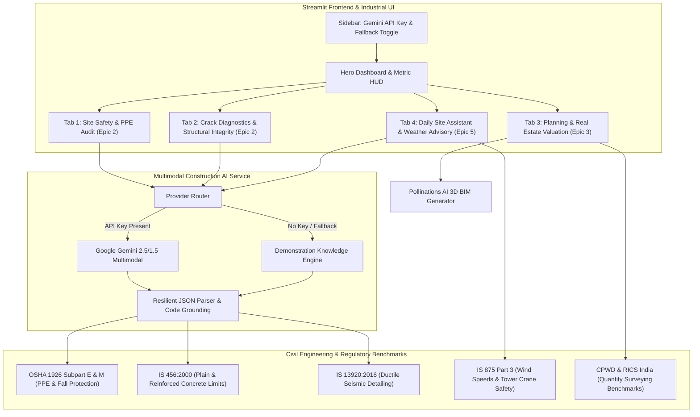

# 🏗️ Multimodal Construction Intelligence Platform
### *Skill Wallet Capstone Project 1 — Autonomous Construction Site Safety, Structural Diagnostics, CapEx Valuation & Weather Advisory*

[](https://streamlit.io/)
[](https://www.python.org/)
[](https://opensource.org/licenses/MIT)
[](#-regulatory-standards--civil-codes)

A production-ready, full-stack AI engineering platform developed for **Skill Wallet Capstone Project 1**. It leverages **Multimodal Computer Vision (Google Gemini 2.5 Flash / 1.5 Pro)** grounded in authoritative civil engineering codes (**OSHA 1926**, **IS 456:2000**, **IS 13920**, **IS 875**, and **CPWD** norms) to autonomously audit site safety, diagnose concrete pathology, calculate real estate CapEx valuations in INR (₹ Lakhs / ₹ Crores), and provide weather-aware field engineering advisories.

Zero external database dependencies. Designed for **1-click instant deployment on Streamlit Community Cloud**.

---

## 🏛️ System Architecture



---

## 🚀 Key Modules & Epic Features

### 1. 🦺 Tab 1: Site Safety & PPE Audit (Epic 2)
- **High-Resolution Photo Ingestion:** Upload site photographs (JPG/PNG) or pick from built-in high-rise rebar, deep excavation, or scaffolding scenarios.
- **Multimodal PPE Matrix:** Evaluates hard hats (Type I/II Class E), high-visibility vests (Class 2/3), steel-toe footwear, safety harnesses (fall arrest > 1.8m), eye goggles, and cut-resistant gloves.
- **Structured Regulatory Scoring:** Outputs `safety_score` (0-100), `overall_status`, compliance ratios, and identifies physical hazards with severity (`Low`, `Medium`, `High`, `Critical`).
- **Corrective Engineering Action Plans:** Actionable remedies referencing OSHA 1926 and IS 3696.
- **Export Formats:** 1-click download of structured JSON report and formal inspection document (`.md`).

### 2. 🔬 Tab 2: Crack Diagnostics & Structural Integrity (Epic 2)
- **Forensic Defect Classification:** Classifies concrete/masonry defects into *Structural Shear Cracks*, *Settlement Cracks*, *Plastic Shrinkage Hairline Cracks*, *Thermal Expansion Joints*, or *Concrete Spalling & Delamination*.
- **Aperture Measurement & Code Tolerances:** Accurately estimates crack width (mm) and benchmarks against **IS 456:2000 Clause 35.3.2** exposure limits (0.30mm mild, 0.20mm moderate, 0.10mm severe).
- **Engineering Repair Protocol:** Step-by-step repair specifications (low-viscosity epoxy pressure injection < 200 cps, polyurethane hydrophilic grouting, CFRP composite wraps, zinc-rich rebar passivator).
- **Interactive Visual Gauge:** Plotly radial gauge comparing detected aperture to permissible structural limit.

### 3. 🏗️ Tab 3: Planning & Real Estate Valuation (Epic 3)
- **Interactive Parameter Inputs:** Structure typology (Residential High-rise, Commercial Tech Park, Industrial PEB Warehouse, Luxury Villa, Hospital), built-up area (sq. ft.), location tier (Tier 1 Metro, Tier 2 Urban, Tier 3 Regional Indian markets), and milestone completion slider (0-100%).
- **Financial & CapEx Modeling:** Calculates total estimated project budget, CapEx incurred to date, cost-to-complete, and current market asset valuation in INR (formatted in **₹ Crores** and **₹ Lakhs**).
- **Civil Quantity Surveying:** Computes Structural TMT Steel requirements (Metric Tonnes) and OPC/PPC Cement requirements (50kg bags and Tonnes) using standard CPWD thumb rules.
- **Conceptual 3D BIM Rendering:** Dynamically generates architectural prompts and synthesizes live 3D conceptual renderings on the fly via **Pollinations AI** with custom seeds.

### 4. 🌦️ Tab 4: Daily Site Assistant & Weather-Aware Advisory (Epic 5)
- **Dynamic Weather Environmental Directives:**
  - *High Wind (> 38 km/h):* Tower crane suspension limits (OSHA 1926.1431 / IS 875), jib weathervaning, suspended cradle lockdown.
  - *Heavy Rain / Monsoon:* Slab concreting halt, water-cement ratio alteration prevention, 30mA RCCB/ELCB electrical de-energizing, excavation dewatering.
  - *Extreme Heat (> 40°C):* Wet ponding/hessian curing protocol, hydration crack mitigation, chilled water mixing, worker heat defense rotations.
  - *Dense Fog / Visibility:* Blind lift ban, radar spotters, speed reductions.
- **Multi-Turn Civil Assistant Chatbot:** Grounded chat assistant answering complex questions on mix design (M20, M25, M30), seismic detailing, formwork stripping times, and regulatory compliance.

---

## 📜 Regulatory Standards & Civil Codes Grounding

| Regulatory Standard | Domain / Scope | Implementation in Platform |
|---|---|---|
| **OSHA 29 CFR 1926 Subpart E & M** | Worker PPE & Fall Protection | Hard hat, eye protection, and fall arrest (>1.8m) compliance verification. |
| **IS 456:2000 (Clause 35.3.2)** | Plain & Reinforced Concrete | Permissible crack widths (0.3mm mild, 0.2mm moderate/severe) and cover depths. |
| **IS 13920:2016** | Ductile Detailing for Seismic Loads | Beam-column shear joint retrofits and stirrup density evaluation. |
| **IS 875 (Part 3):2015** | Design Wind Loads & Lifting Protocols | Tower crane 38 km/h cutoff and storm out-of-service weathervaning. |
| **IS 15809 / IS 2925 / IS 15298** | Indian Personal Protective Standards | Industrial helmets, reflective vests, and safety footwear criteria. |
| **CPWD & RICS India 2025-2026** | Quantity Surveying & Cost Indices | Steel (3.5 - 6.0 kg/sqft) and Cement (0.32 - 0.48 bags/sqft) benchmark thumb rules. |

---

## 💻 Local Installation & Quickstart

### 1. Clone & Set Up Virtual Environment
```bash
git clone https://github.com/your-username/multimodal-construction-intelligence.git
cd multimodal-construction-intelligence

python -m venv venv
# On Windows:
.\venv\Scripts\activate
# On Linux/macOS:
source venv/bin/activate
```

### 2. Install Dependencies
```bash
pip install -r requirements.txt
```

### 3. Run Automated System Test Suite
```bash
python test_app.py
```
*Expected Output:*
```text
Testing core imports...
Core third-party imports successful!
Testing local utilities...
Currency formatting passed: 2.5 Cr => ₹ 2.50 Cr, 4.5 Lakh => ₹ 4.50 Lakh
Helper utilities tests passed!
Testing Plotly chart builders...
All Plotly chart generations passed!
Testing Construction AI Service in Demonstration Mode...
PPE Audit Test Passed: Score=72, Status=Needs Attention (Minor Violations)
Crack Diagnostic Test Passed: Defect=Structural Shear Crack, Width=1.85mm
Chat Assistant Knowledge Retrieval Passed!
Testing Planning & Valuation Calculations...
Valuation & Quantity Surveying Test Passed: Budget=₹31.72 Cr, Steel=420.0 MT, Cement=42,000 bags

========================================================
✅ ALL CAPSTONE PROJECT 1 UNIT & INTEGRATION TESTS PASSED!
========================================================
```

### 4. Launch the Streamlit Platform
```bash
streamlit run app.py
```
Open your browser at `http://localhost:8501`.

---

## ☁️ 1-Click Streamlit Community Cloud Deployment

1. Push this repository to GitHub.
2. Log into [share.streamlit.io](https://share.streamlit.io/).
3. Click **"New App"** and select your repository, branch (`main`), and main file path (`app.py`).
4. (Optional) In **Advanced Settings -> Secrets**, add:
   ```toml
   GEMINI_API_KEY = "AIzaSy..."
   ```
5. Click **"Deploy!"** — the platform launches immediately. If no API key is added, it runs seamlessly in Standalone Demonstration Mode with full functionality.

---

## 📂 Project Directory Structure

```text
├── .streamlit/
│   └── config.toml             # Industrial Safety Theme (Amber/Slate palette)
├── modules/
│   ├── __init__.py
│   ├── ai_service.py           # Gemini Multimodal client + Demo fallback
│   ├── demo_data.py            # High-fidelity realistic site, crack & weather scenarios
│   ├── safety_audit.py         # Tab 1: PPE & Site Safety Audit (Epic 2)
│   ├── crack_diagnostics.py    # Tab 2: Crack Pathology & Diagnostics (Epic 2)
│   ├── planning_valuation.py   # Tab 3: CapEx Valuation & BIM 3D Render (Epic 3)
│   └── site_assistant.py       # Tab 4: Weather Protocols & Engineering Chatbot (Epic 5)
├── utils/
│   ├── __init__.py
│   ├── styles.py               # Glassmorphism CSS, hazard badges, and metric cards
│   ├── helpers.py              # Base64 image encoding, JSON parser, INR formatter
│   └── charts.py               # Plotly gauges, material progress & donut charts
├── .env.example                # Sample environment variables
├── .gitignore                  # Git ignore rules
├── requirements.txt            # Cloud deployment dependencies
├── test_app.py                 # Automated unit & integration test suite
├── README.md                   # System documentation
└── app.py                      # Main Streamlit application entrypoint
```

---

## 🛡️ License
Released under the [MIT License](LICENSE). Developed for **Skill Wallet Capstone Project 1**.
